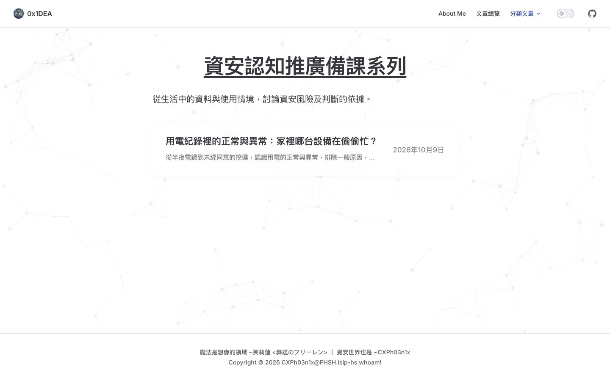

# 認知推廣備課系列 listing 修正結果

已在 T-0010 本機分支修正：分類頁恢復既有 NewPost listing，與資安教學備課系列使用同一套文章列，包含標題、摘要與日期。保留系列介紹，只列出已發布的用電文章。

原因是 PR #17 帶入手寫 Markdown 清單，沒有分類篩選及 NewPost。先前發布準備為避開新增可執行 Markdown 的限制而採用靜態清單，審查也未驗收分類 listing 與既有系列一致。本次重用已存在的分類模板，經獨立審查及隔離 build，不放寬 publication CLI 限制。

| 驗證 | 結果 |
|---|---|
| Vitest | 54 項成功 |
| Python harness | 66 項成功，無 skip |
| Python publication | 16 項成功，無 skip |
| lint、structure、materializer、公開 verifier | exit 0 |
| OS sandbox build | exit 0；外部讀寫與網路探針皆被拒絕 |
| 實際瀏覽器 | 桌面／手機、明暗模式正常；只有一篇；Tab／Enter 開啟文章；無水平溢出 |
| 獨立審查 | Standards／Spec 未解決 P0/P1/P2 皆為 0；安全 HIGH/MEDIUM 皆為 0 |

手機以實際 DOM 量得 window390×844、內容375×844，內容與 scrollWidth 相符。截圖 API 輸出375×812 JPEG，不能將截圖尺寸當作 viewport；初次 Spec 審查提出的證據問題已保留並補驗關閉。既有四個 Font Awesome stylesheet404 在修正前後皆存在，未因本次新增，詳見審查限制。

1719 個既有 release entries 中，1716 個未變；差異只有此分類 index 及 T-0010 原本的兩個 tracked verifier／harness 修正。文章內容、時間、圖片、package／lockfile、原 scope 與歷史證據 bytes 完全保留，其他五篇 staging 候選沒有被帶入，原 staging checkout 仍乾淨。

未 commit、push、開 PR、merge 或部署；遠端正式站尚未套用此修正。完整證據見 coverage-report.md、diagnosis.md、review/ 與 evidence/。

