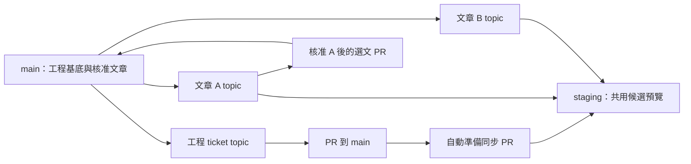

# 請確認：共用 staging 的發布 workflow

本輪已完成 spec、traceability、24 項測試計畫及 workflow skill 草案。
四軸審查共兩輪，最後剩餘 P0／P1／P2＝0／0／0。文件尚待作者確認，沒有開始新版工具或自動化實作。

先看 [繁體中文規格](spec.zh-TW.md)；[English spec](spec.en.md) 是實作依據。
中文稽核版綁定 English Git blob `a3f0c03754c389d40ca9fb97d8bb7c1ae992651b`。

| 工作 | 核准後的流程 |
|---|---|
| 共同工程基底 | 盤點兩邊差異，工程／管理修正從 main 開 PR；候選正文、未核准修訂與專屬圖片不進 main |
| 日常工程修正 | main-based ticket topic → main PR → 自動準備／驗證同步 PR 到 staging |
| 文章審稿 | main-based article topic → staging 整合；作者使用同一個 staging 網址檢閱所有候選 |
| 指定文章發布 | current main + 核准文章 A + 精確依賴 → 選文 PR 到 main；B 繼續留 staging |
| 合併 | 初版自動化只開／更新 PR；仍由作者決定 merge |

需要一起確認的設計選擇：

- **歷史契約保留。** V1 仍拒絕已整合 staging、尚未在 main 的來源；另訂 v2，允許乾淨 topic 的正常預覽整合，拒絕 staging integration ancestry、其他候選及先加入再 revert 的污染。
- **候選也包含既有文章的新修訂。** Main 保留該篇已發布版本；不把尚未核准的修訂帶入。同步即使沒有 Git 衝突，只要改變候選 bytes/mode/metadata，也先停止、更新來源與核准紀錄。
- **初版只自動開／更新同步 PR。** 指定一個永久 ticket-owned 操作分支，最多一個 open sync PR；衝突、過期 refs、驗證失敗都停止，不 force push。
- **驗證採明確關卡。** V2 的任一必要檢查失敗、缺少、blocked 或 `exclusion-unverified` 都不能 PR-ready。這可能阻擋沒有可辨識輸出特徵的短修訂；規格沒有隱含人工覆寫。
- **啟用有獨立前置條件。** 實際 GitHub 權限、required checks、latest-base protection、dispatch/run 必須查核；本機測試不能代替已授權的遠端演練。部署設定不在本輪範圍。
- **Done 契約不變。** 仍須實際授權 staging 祖先與驗收證據；main-only 落地或 PR-ready 都不直接算 done。

[測試計畫](test-plan.md) 共 24 項，涵蓋基底／歷史、v2 來源、同步／競爭、Actions 信任、指定發布／輸出、網站與回復。
新 seams 是 v2 admission、sync planning 與 GitHub/Actions adapter；遠端演練另外取得授權。
本輪只執行 skill 作者驗證與文件／現有結構檢查，沒有新增產品測試或宣稱新版功能可用。

[Skill 草案](skill-draft/managing-article-publication/SKILL.md) 延伸既有 `$managing-article-publication`，保留四個 product packages。
兩份舊 reference 逐位元組相同；四種請求的獨立推演完成，修正三項使用歧義後複核無剩餘歧義。
它仍在規格目錄，沒有取代 canonical/generated skill，也沒有安裝到 global skills。

審查與證據：[Round 1](review/round-1.md)、[Round 2](review/round-2.md)、[skill 推演](review/skill-evaluation/report.md)、
[traceability](traceability.md)、[來源查核](source-evidence.md)、[ADR 提案](adr-proposal.md)、[本輪驗證](review/validation.md)。

確認範圍是這份 spec、24 項測試計畫／新 seams、操作分支提案及 skill 草案。
確認後再依專案流程拆票、核准 breakdown 與進行 TDD；不因確認規格就自動 merge PR 或啟用外部設定。
本輪沒有配置 ticket、修改文章或部署設定，也沒有 commit、push、開 PR 或 merge。
